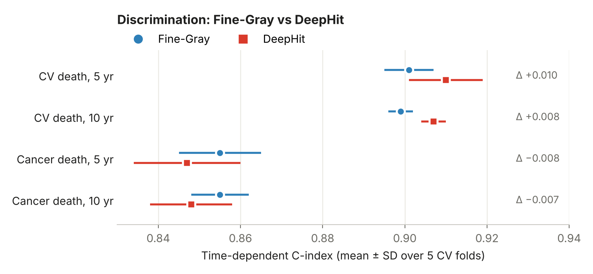
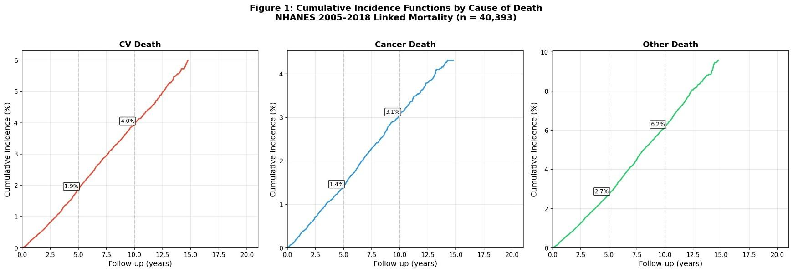
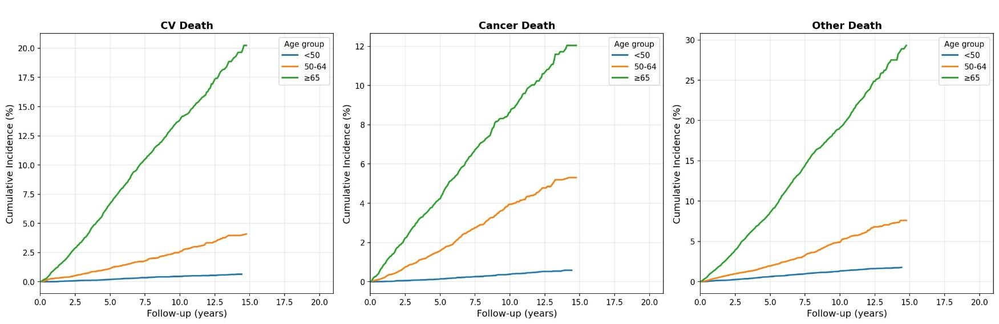
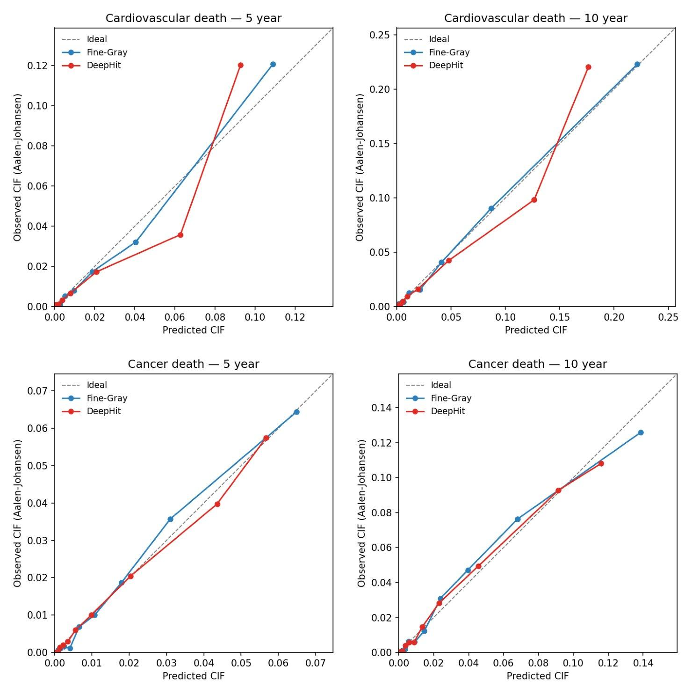
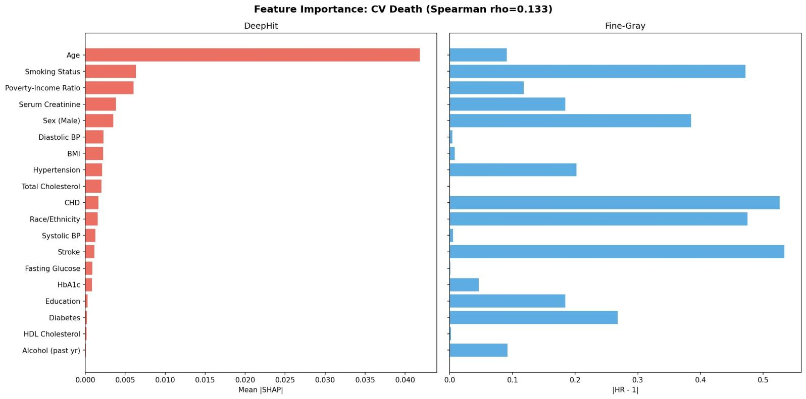
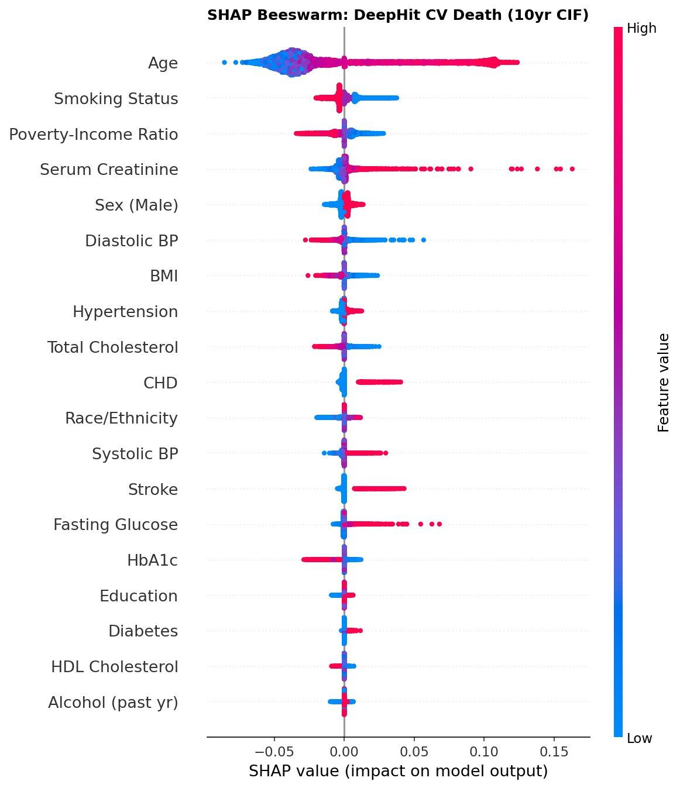

# Deep learning vs Fine-Gray for competing-risks mortality (NHANES 2005–2018)

Does a deep-learning survival model (**DeepHit**) predict cause-specific death better than the classical **Fine-Gray** subdistribution hazard model?

This repository holds the full analysis pipeline for my MSc thesis in Bioinformatics and Biostatistics (Universitat Oberta de Catalunya, 2026). The thesis is in [`docs/thesis_deephit_vs_finegray.pdf`](docs/thesis_deephit_vs_finegray.pdf).

**Short answer: no.** On ~40,000 US adults with 19 standard clinical predictors, both models discriminate very well (C-index ≈ 0.90 for cardiovascular death, ≈ 0.85 for cancer death) and are equally well calibrated. DeepHit is marginally ahead for cardiovascular death, Fine-Gray is slightly but consistently ahead for cancer death, and every difference is ≤ 0.01. For low-dimensional tabular data, Fine-Gray remains a strong, interpretable default.



---

## The question

When people can die of several causes, ordinary survival models (Kaplan–Meier, Cox) overestimate the risk of any single cause, because they treat deaths from other causes as if those people could still go on to have the event. Competing-risks models fix this.

- **Fine-Gray** is the standard: a regression on the subdistribution hazard that gives the cumulative incidence of one cause directly. It assumes proportional subdistribution hazards and is linear in the covariates.
- **DeepHit** (Lee et al., 2018) is a neural network that learns the joint distribution of event time and cause with no proportionality assumption and can capture non-linear effects and interactions.

The hypothesis was that a properly tuned DeepHit would beat Fine-Gray on discrimination and calibration. The study tests that head-to-head on identical cross-validation folds, then compares how each model explains its predictions (hazard ratios vs SHAP).

## Data

| | |
|---|---|
| **Source** | NHANES continuous cycles 2005–2006 through 2017–2018 (7 cycles), linked to the NCHS public-use Linked Mortality Files (follow-up to 31 Dec 2019) |
| **Cohort** | 40,393 adults aged ≥ 18, eligible for mortality linkage, valid follow-up and exam weight; prior cancer at baseline excluded |
| **Follow-up** | Median 7.4 years (IQR 4.1–10.8), ~303,000 person-years |
| **Outcomes** | Event 1 cardiovascular death (heart disease + cerebrovascular), Event 2 cancer death, Event 3 all other causes; alive = censored |
| **Events** | 1,264 CV deaths (3.1%), 972 cancer deaths (2.4%), 1,983 other deaths (4.9%), 36,174 censored (89.6%) |
| **Predictors (19)** | Age, sex, race/ethnicity, education, poverty-income ratio, BMI, smoking status, past-year alcohol, hypertension, diabetes, CHD, stroke, systolic/diastolic BP, HbA1c, total and HDL cholesterol, serum creatinine, fasting glucose |

All data are public and de-identified. Nothing is stored in this repo: `part1_data_acquisition.R` downloads the NHANES tables (via `nhanesA`) and the mortality `.dat` files from the CDC FTP server.



*Aalen–Johansen cumulative incidence for each cause in the full cohort. At 10 years: 4.0% CV death, 3.1% cancer death, 6.2% other causes.*



*Age is by far the strongest gradient: participants aged ≥ 65 reach a CV cumulative incidence above 20% by the end of follow-up.*

## Methods

1. **Cohort construction.** Merge seven cycles on `SEQN`, join the linked mortality files, apply eligibility criteria, rescale exam weights for pooled cycles.
2. **Cleaning.** Harmonise labels across cycles, derive smoking status, drop any variable with > 40% missingness in a cycle.
3. **Multiple imputation.** MICE with 20 imputed datasets, 10 iterations, seed 2024. Event indicator, follow-up time and cycle are auxiliary predictors only.
4. **Fine-Gray.** One model per cause (`cmprsk::crr`), other causes as the competing event. Subdistribution hazard ratios pooled over all 20 imputations with Rubin's rules.
5. **DeepHit.** `pycox` on PyTorch: shared MLP → probability mass over 3 causes × 100 time intervals, combined likelihood + ranking loss. Tuned with Optuna (TPE, 100 trials). Final configuration: 4 layers × 32 nodes, dropout 0.5, lr 0.00989, batch 256, α 0.5, σ 0.8 (see [`deephit_best_params.json`](deephit_best_params.json)).
6. **Evaluation.** Identical 5-fold CV splits, stratified by event type and shared by both models. Time-dependent C-index and Brier score at 5 and 10 years; calibration curves with the Integrated Calibration Index (observed risk by Aalen–Johansen within deciles of predicted risk).
7. **Sensitivity analyses.** IPCW-weighted competing-risks C-index, pooling over all 20 imputations, fold-level ranges for the model differences.
8. **Interpretability.** Kernel SHAP on DeepHit's 10-year CIF, compared with Fine-Gray |HR − 1| via Spearman rank correlation.

## Main results

### Discrimination and calibration (5-fold CV, mean ± SD)

| Outcome | Horizon | C-index Fine-Gray | C-index DeepHit | Brier Fine-Gray | Brier DeepHit |
|---|---|---|---|---|---|
| CV death | 5 yr | 0.901 ± 0.006 | **0.910** ± 0.009 | **0.0207** | 0.0212 |
| CV death | 10 yr | 0.899 ± 0.003 | **0.907** ± 0.003 | **0.0607** | 0.0638 |
| Cancer death | 5 yr | **0.855** ± 0.010 | 0.847 ± 0.013 | **0.0170** | 0.0171 |
| Cancer death | 10 yr | **0.855** ± 0.007 | 0.848 ± 0.010 | **0.0562** | 0.0571 |

- **No DeepHit advantage.** All C-index differences are ≤ 0.01. Under the more defensible IPCW competing-risks C-index, the CV-death gap shrinks to ~0.003 while Fine-Gray's cancer-death lead (0.007–0.011) holds in every fold.
- **Censoring doesn't inflate the numbers.** IPCW weighting changed every C-index by ≤ 0.002 despite ~90% censoring.
- **Single imputation was enough.** Pooling over all 20 imputations moved estimates negligibly (between-imputation SD ≤ 0.001).
- **Both are well calibrated.** ICI 0.014–0.020 at 5 years and 0.038–0.053 at 10 years; DeepHit is less stable in the top CV-risk decile.



### Key Fine-Gray hazard ratios (pooled over 20 imputations)

| Cardiovascular death | sHR (95% CI) | Cancer death | sHR (95% CI) |
|---|---|---|---|
| Prior stroke | 1.53 (1.30–1.81) | Current smoker | 2.54 (2.12–3.04) |
| Coronary heart disease | 1.53 (1.30–1.79) | Former smoker | 1.49 (1.28–1.74) |
| Current smoker | 1.47 (1.24–1.76) | Male sex | 1.39 (1.20–1.62) |
| Male sex | 1.39 (1.21–1.59) | Hypertension | 1.23 (1.06–1.42) |
| Diabetes | 1.27 (1.07–1.50) | Age (per year) | 1.08 (1.07–1.08) |
| Age (per year) | 1.09 (1.08–1.10) | | |

### Interpretability: same predictions, different explanations

The two models rank features very differently (Spearman ρ = 0.13 for CV death, 0.48 for cancer death). This is not a disagreement about risk. A hazard ratio measures the *conditional* effect of switching a variable on, so rare binary comorbidities like stroke score high. Mean |SHAP| measures the *average* contribution across the cohort, so age, which spans six decades, dominates.





## Repository structure

```
part1_data_acquisition.R       Download NHANES + linked mortality, build the cohort
part2_cleaning.py              Harmonise labels, missingness screen
part2_5_mice_imputation.R      MICE, 20 imputations
part3_descriptive_analysis.py  Table 1, cumulative incidence plots, correlation/VIF
part4_finegray.R               Fine-Gray, Rubin pooling, 5-fold CV, writes fold indices
part5_deephitbetterpar.py      DeepHit + Optuna tuning + 5-fold CV
part6_shapbetterpar.py         SHAP values, importance comparison, beeswarm/waterfall plots
part7_recompute_stage1.py      Sensitivity: IPCW C-index, 20-imputation pooling, differences
part8_calibrationref.py        Calibration curves + ICI
deephit_best_params.json       Final DeepHit hyperparameters (thesis Appendix A)
figures/                       Figures used in this README
docs/                          Thesis PDF
```

## How to run

### Requirements

- **R ≥ 4.3** with `nhanesA`, `dplyr`, `tidyr`, `haven`, `survey`, `readr`, `mice`, `ggplot2`, `lattice`, `cmprsk`, `survival`
- **Python ≥ 3.10** with the packages in [`requirements.txt`](requirements.txt)
- A GPU is recommended for parts 5–8 (CPU works, but slowly)

```bash
git clone https://github.com/castromigsman-a11y/competing-risks-mortality-nhanes.git
cd competing-risks-mortality-nhanes

# Python environment
python -m venv .venv && source .venv/bin/activate
pip install -r requirements.txt

# R packages
Rscript -e 'install.packages(c("nhanesA","dplyr","tidyr","haven","survey","readr","mice","ggplot2","lattice","cmprsk","survival"))'
```

### Pipeline

Run the scripts in order from the repository root. Each one reads the previous step's CSV from the working directory.

```bash
Rscript part1_data_acquisition.R        # -> nhanes_analytic_cohort.csv (needs internet)
python  part2_cleaning.py               # -> nhanes_clean_for_imputation.csv
Rscript part2_5_mice_imputation.R       # -> nhanes_imputed_stacked.csv
python  part3_descriptive_analysis.py   # -> descriptive figures
Rscript part4_finegray.R                # -> finegray_*.csv, cv_fold_indices.csv
python  part5_deephitbetterpar.py       # -> deephit_*.csv, deephit_best_params.json
python  part6_shapbetterpar.py          # -> SHAP figures, shap_feature_importance.csv
python  part7_recompute_stage1.py       # -> stage1_*.csv (sensitivity analyses)
python  part8_calibrationref.py         # -> calibration_*.png, calibration_ici_summary.csv
```

**Runtime notes.** MICE (part 2.5) takes a while. Part 5 runs 100 Optuna trials; lower `N_OPTUNA_TRIALS` for a quick test. Part 6 (Kernel SHAP) is the slowest step; reduce `N_EXPLAIN` then `N_SHAP_SAMPLES` if needed. Part 7 refits both models 100 times (~1–2 h on GPU); set `N_IMPUTATIONS = 1` to smoke-test it in ~5 min.

**Skipping the tuning.** Running part 5 overwrites `deephit_best_params.json`. Parts 6–8 read that file, so to reproduce the thesis numbers without re-tuning, keep the committed file and run part 5 only if you want to re-tune.

All random seeds are fixed at 2024.

## Limitations

- The proportional subdistribution hazards assumption was not formally tested.
- Separate per-cause Fine-Gray models can produce summed CIFs above 1; this happened for one participant at 10 years.
- Models are trained unweighted, so predictions describe the analytic sample rather than the survey-weighted US population.
- No external validation cohort, and no subgroup (e.g. race/ethnicity) performance evaluation.

## Citation

```
Castro, M. A. M. (2026). Deep Learning for Competing Risk Analysis: A Comparative Study of
DeepHit and Fine-Gray Models in Multi-Cause Mortality Prediction. MSc thesis,
Universitat Oberta de Catalunya.
```

## License

The code in this repository is released under the [MIT License](LICENSE).
The thesis PDF in `docs/` is not covered by the MIT License; it is distributed under the terms stated on its front matter (CC BY-NC-ND 3.0).
NHANES and NCHS linked mortality data are public-domain data from the US Centers for Disease Control and Prevention.
